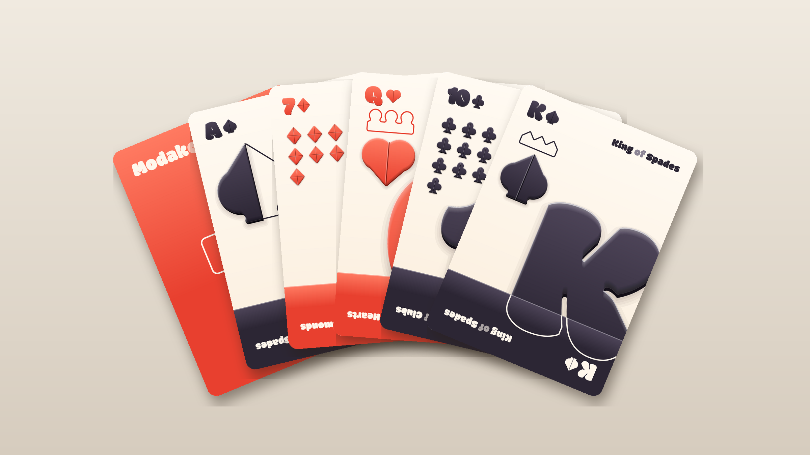
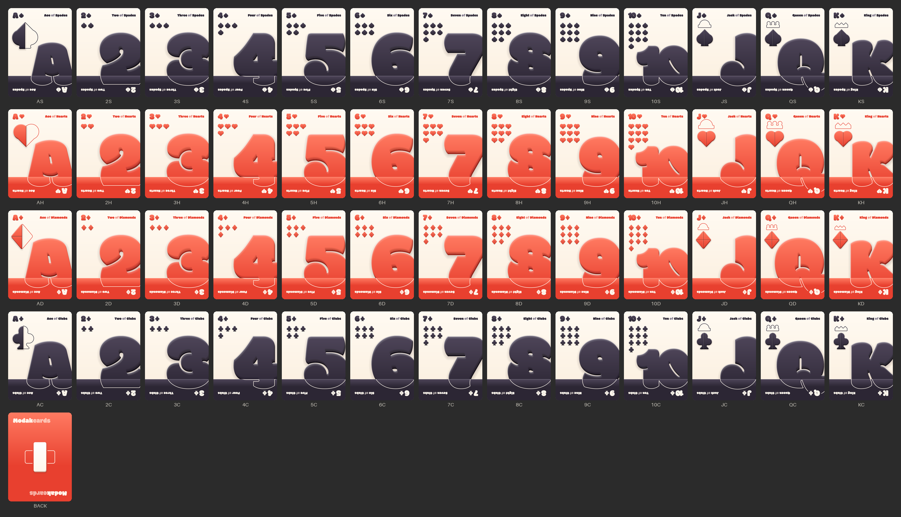
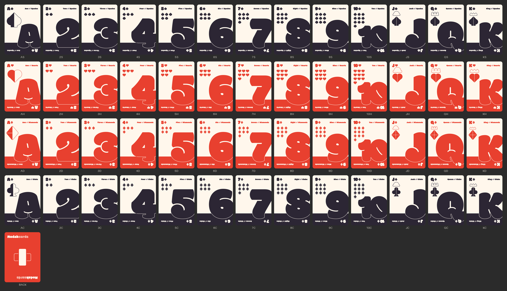
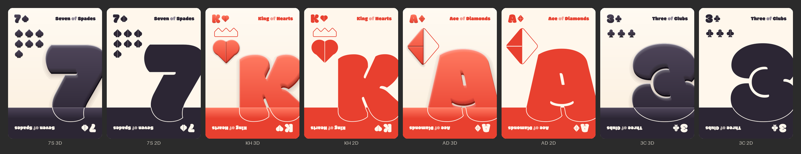

# Modak cards

A 52-card deck (plus card back) as code-generated vector art, in two editions:

- **3D** (`deck/3d/`): puffy, extruded shapes inspired by Scott Newland's *Hiero Display*.
- **2D** (`deck/2d/`): the same layout, flat, in case the 3D look is too much.

The layout follows Ryan Myers' *Helveticards*. The type is [Modak](https://fonts.google.com/specimen/Modak) by Ek Type. All artwork is generated from code.

This is a first draft. The layout and the 3D treatment are still being explored.



## Deck



## Flat edition





## Design

**Layout (from Helveticards).** A quiet paper card. The index and a grid of pips sit top-left, and the full card name runs top-right ("Five *of* Clubs"). A huge rank numeral bleeds off the right edge and sinks into a solid color band at the bottom. Inside the band, the numeral continues as a paper-colored outline. The inverted index and name sit in the band so the card still reads upside down. The numeral shrinks automatically when it would crowd the pips, index or name.

**Type (Modak).** Every letter and numeral is Modak, outlined to paths with HarfBuzz and fontTools. The SVGs have no font dependency. On the 10, the digits are tracked tight so they melt together like Modak's ligatures.

**Shapes (from Hiero).** The suit symbols are built from Hiero's primitives: circles, 3×7 rectangles and right triangles. They are unioned, then "plumped" (concave corners filled, convex corners rounded) so they sit with Modak's soft weight. Seams are left where the primitives meet. Hiero's solid-versus-wireframe contrast shows up in three places:

- Aces: the big suit is half solid, half wireframe.
- Courts (J, Q, K): a wireframe crown (dome, pearls, spikes) built on a 3×7 bar, over a solid suit.
- Back: a solid vertical 3×7 bar crossed by a wireframe bar (a nod to Helveticards' Swiss cross), with a two-tone "Modak**cards**" wordmark.

**3D without filters.** The 3D edition uses no SVG filters or bitmaps, so it renders the same everywhere and stays editable. Each shape is plain vector layers: a soft contact shadow (stacked translucent strokes), a swept extrusion side, a gradient face, a bevel made of many faint strips, a rim highlight and seam grooves.

**Palette.** Paper `#FFF7EC`, ink `#2C2634` (spades, clubs), red `#E8402F` (hearts, diamonds).

## Where things are

| Path | What |
| --- | --- |
| `deck/3d/*.svg` | the 52 faces + `BACK.svg`, 3D edition (750 × 1050) |
| `deck/2d/*.svg` | the same set, flat |
| `assets/suits/{3d,2d}/` | spade, heart, diamond and club symbols, 512 × 512 |
| `previews/` | `presentation-*.png`, `contact-*.png`, `compare-3d-vs-2d.png`; per-card PNGs go to `previews/<edition>/png/` (not committed) |
| `fonts/` | `Modak-Regular.ttf` + `OFL.txt` |
| `modak_cards/` | generator source |
| `refs/SOURCES.md` | links to the reference material (the images themselves are not committed) |

Card IDs are rank + suit letter: `A 2 … 10 J Q K` + `S H D C`.

Cards are 750×1050 px, which is 2.5×3.5 in (poker size) at 300 dpi, with 36 px corner radius. There is no print bleed yet. The 3D cards are larger files (about 25 to 230 KB each, around 110 KB typical) because of the bevel and shadow layers. The 2D cards are about 16 to 32 KB.

## Build

Needs Python 3.10+ and `rsvg-convert` for the PNG previews.

```sh
python3 -m venv .venv
.venv/bin/pip install -r requirements.txt
.venv/bin/python -m modak_cards.build                  # both editions + previews (~15 s)
.venv/bin/python -m modak_cards.build --style 2d       # one edition
.venv/bin/python -m modak_cards.build --only AS,10H    # a few cards
.venv/bin/python -m modak_cards.build --no-preview     # SVG only
```

The build is deterministic: the same source produces byte-identical SVGs.

Source map:

| Module | Role |
| --- | --- |
| `geom.py` | Path primitives and boolean ops (skia-pathops): union, offset, soften, sweep |
| `typeset.py` | Modak text to outlines (HarfBuzz shaping, cap-height sizing, tracking) |
| `suits.py` | Hiero-built suit symbols, seams, optical sizes, court crowns |
| `render.py` | Palettes, the SVG writer, and the `Flat2D` and `Puffy3D` styles |
| `cards.py` | Card layout: index, name, pips, numeral, band, aces, courts, back |
| `build.py` | CLI, parallel build, previews |

## Credits and licensing

- **Modak** © Ek Type, licensed under the SIL Open Font License 1.1 (`fonts/OFL.txt`). The cards contain outlined Modak glyphs.
- **Helveticards** by Ryan Myers and **Hiero Display** by Scott Newland are references only. No artwork from either is copied into the cards, and their images are not in this repository. `refs/SOURCES.md` links to them.
